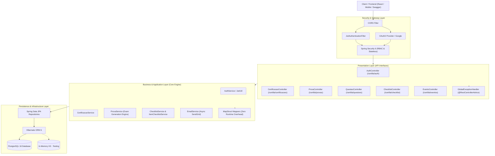

# CertifAI Backend

[](https://github.com/mayeufraferreira/certifai-backend/actions)


---

## 🎯 Visão Geral e Problema de Negócio

A preparação para exames de certificações técnicas de alta complexidade (AWS, Azure, GCP, Kubernetes, Scrum, etc.) exige consistência, organização metódica e avaliação contínua. Estudantes e profissionais frequentemente enfrentam dificuldades como:
- Falta de simulados realistas com questões parametrizadas por nível de dificuldade;
- Dificuldade para gerenciar cronogramas e trilhas de estudo estruturadas;
- Ausência de métricas e histórico de evolução e desempenho em tempo real.

O **CertifAI** foi concebido para solucionar essas dores. O backend atua como o motor transacional e de inteligência da plataforma, fornecendo:
1. **Motor de Geração de Provas e Simulados:** Montagem dinâmica e personalizada de exames baseada em banco de questões, categorização por domínio e algoritmos de aleatorização ponderada;
2. **Controle de Cronograma e Trilhas de Estudo:** Gestão hierárquica de checklists com itens rastreáveis e agendamento de sessões com lembretes;
3. **Autenticação Híbrida Segura:** Suporte a credenciais locais (JWT stateless com rotação/revogação) e OAuth2 Social Login via Google;
4. **Comunicação Assíncrona e Notificações:** Envio não-bloqueante de tokens de verificação de conta e recuperação de credenciais via SendGrid.

---

## 🏗️ Arquitetura e Decisões Técnicas (Trade-offs)

O CertifAI adota os princípios de **Clean Architecture** e **Separation of Concerns**, estruturado em camadas desacopladas com contratos bem definidos via interfaces Java.

### Diagrama Arquitetural



### Principais Padrões e Decisões Técnicas

1. **Separação Rígida em Camadas (Controller -> Service -> Repository):**
   - **Trade-off:** Exige boilerplate adicional com DTOs e mappers, mas garante isolamento absoluto do modelo de domínio (`br.com.certifai.model`), impedindo vazamento de dados de persistência para o cliente HTTP.
2. **Mapeamento Compile-Time com MapStruct (v1.6.3):**
   - Elimina reflexão em tempo de execução típica de frameworks como ModelMapper, reduzindo alocação de memória e aumentando a taxa de transferência (*throughput*).
3. **Tratamento Global de Exceções Padronizado (`@RestControllerAdvice`):**
   - Implementação de respostas de erro consistentes contendo `timestamp`, `status`, `error`, `message`, `path` e detalhamento campo a campo para erros de validação (`MethodArgumentNotValidException`).
4. **Observabilidade e Logging Estruturado (SLF4J/Logback):**
   - Remoção de saídas padrão (`System.out` / `e.printStackTrace()`), substituídas por logs com níveis semânticos (`INFO`, `WARN`, `DEBUG`, `ERROR`), viabilizando ingestão em ferramentas como Datadog, ELK ou Grafana Loki.
5. **Autonomia da Suíte de Testes (H2 In-Memory Profile):**
   - A suíte de testes de integração roda sobre banco de dados H2 simulando modo PostgreSQL (`MODE=PostgreSQL;DB_CLOSE_DELAY=-1`), permitindo execução 100% autônoma e determinística tanto em máquinas locais quanto em esteiras de CI/CD sem dependência de containers externos.

---

## 🛠️ Stack Tecnológica

| Componente | Tecnologia | Versão |
| :--- | :--- | :--- |
| **Linguagem** | Java (OpenJDK LTS) | `21` |
| **Framework Base** | Spring Boot | `3.5.0` |
| **Segurança** | Spring Security & OAuth2 Client | `6.x` |
| **Autenticação JWT** | Auth0 `java-jwt` / `jjwt` | `4.4.0` / `0.11.5` |
| **Persistência / ORM** | Spring Data JPA / Hibernate | `6.x` |
| **Banco de Dados Produção**| PostgreSQL | `16-alpine` |
| **Banco de Dados Testes**  | H2 Database Engine | `2.3.232` |
| **Mapeamento de Objetos**  | MapStruct | `1.6.3` |
| **Documentação OpenAPI**   | Springdoc OpenAPI UI | `2.6.0` |
| **Serviço de E-mail**      | SendGrid Java SDK | `4.10.0` |
| **Testes Automatizados**   | JUnit 5, Mockito, Spring Security Test | `5.12.1` |
| **Conteinerização**        | Docker & Docker Compose | Multi-Stage (Alpine) |
| **CI / CD**                | GitHub Actions | v4 |

---

## 🚀 Como Executar Localmente (Quickstart)

### Pré-requisitos
- **Git**
- **Docker & Docker Compose** (para Opção 1)
- **Java 21 JDK** & **PostgreSQL** instalado (apenas para Opção 2)

---

### Opção 1: Execução Via Docker Compose (Recomendado)

O projeto possui um ambiente pré-configurado com PostgreSQL e backend conteinerizado:

1. Clone o repositório e acesse a pasta:
   ```bash
   git clone https://github.com/mayeufraferreira/certifai-backend.git
   cd certifai-backend
   ```

2. Suba o ambiente completo (banco de dados com healthcheck e aplicação):
   ```bash
   docker compose up --build
   ```

3. A aplicação estará disponível em `http://localhost:8080/certifai`.
   - O banco de dados iniciará automaticamente na porta `5432`.
   - Um usuário administrador padrão será inicializado automaticamente na primeira subida (`admin@certifai.com.br`).

---

### Opção 2: Execução Nativa (Local)

1. Clone o repositório e copie as variáveis de ambiente:
   ```bash
   cp .env.example .env
   ```

2. Certifique-se de que sua instância local do PostgreSQL esteja ativa e configure as credenciais no arquivo `.env` ou em seu shell:
   ```bash
   export DATASOURCE_URL="jdbc:postgresql://localhost:5432/certifai_db"
   export DATASOURCE_USERNAME="seu_usuario"
   export DATASOURCE_PASSWORD="sua_senha"
   export JWT_SECRET="404E635266556A586E3272357538782F413F4428472B4B6250645367566B5970"
   export ADMIN_EMAIL="admin@certifai.com.br"
   export ADMIN_PASSWORD="Admin@SecurePass123!"
   ```

3. Compile e execute a aplicação via Maven Wrapper:
   ```bash
   ./mvnw spring-boot:run
   ```

---

## 📖 Documentação da API (OpenAPI / Swagger)

Com a aplicação em execução, acesse a documentação interativa com suporte para testes diretos via Swagger UI:

- **Swagger UI:** [http://localhost:8080/certifai/swagger-ui.html](http://localhost:8080/certifai/swagger-ui.html)
- **OpenAPI JSON Spec:** [http://localhost:8080/certifai/v3/api-docs](http://localhost:8080/certifai/v3/api-docs)

### Resumo dos Principais Endpoints REST

| Módulo | Método | Rota | Descrição | Acesso |
| :--- | :--- | :--- | :--- | :--- |
| **Autenticação** | `POST` | `/auth/login` | Login com e-mail/senha e emissão de JWT | Público |
| **Autenticação** | `POST` | `/auth/register` | Cadastro de novo usuário | Admin |
| **Autenticação** | `GET`  | `/auth/verify` | Confirmação de e-mail via token | Público |
| **Autenticação** | `POST` | `/auth/esqueci-senha` | Solicitação de recuperação de senha | Público |
| **Autenticação** | `POST` | `/auth/reset-password`| Redefinição de senha com token | Público |
| **Autenticação** | `GET`  | `/auth/me` | Dados do usuário autenticado | Autenticado |
| **Certificações**| `GET`  | `/certificacoes` | Listar certificações disponíveis | Autenticado |
| **Certificações**| `POST` | `/certificacoes` | Cadastrar nova certificação | Autenticado |
| **Certificações**| `GET`  | `/certificacoes/{id}`| Detalhes da certificação | Autenticado |
| **Provas**       | `POST` | `/provas/montar-personalizada` | Montar simulado dinâmico por dificuldade | Autenticado |
| **Provas**       | `POST` | `/provas/{id}/iniciar` | Iniciar execução de prova | Autenticado |
| **Provas**       | `POST` | `/provas/{id}/finalizar`| Finalizar e calcular pontuação | Autenticado |
| **Questões**     | `GET`  | `/questoes` | Listar banco de questões | Autenticado |
| **Questões**     | `POST` | `/questoes` | Cadastrar questão e alternativas | Autenticado |
| **Checklists**   | `POST` | `/checklist` | Criar plano de checklist de estudo | Autenticado |
| **Checklists**   | `GET`  | `/checklist/{id}` | Buscar checklist e itens | Autenticado |
| **Itens**        | `POST` | `/checklists/{id}/itens` | Adicionar tarefa ao checklist | Autenticado |
| **Eventos**      | `GET`  | `/eventos` | Listar agenda de estudos | Autenticado |
| **Usuários**     | `GET`  | `/usuarios` | Listar todos os usuários | Admin |

---

## 🧪 Qualidade de Código e Testes Automatizados

A aplicação possui **100% de taxa de sucesso** em seus testes automatizados cobrindo testes unitários de domínio e testes de integração com MockMvc e in-memory database:

```bash
# Executar a suíte completa de testes automatizados
./mvnw clean test
```

### Estratégia de Testes

- **Testes Unitários (`src/test/java/.../services/`):**
  - Foco em isolamento e regras de negócio puras (cálculo de pontuação de prova, geração randômica de questões, validação de token, regras de conclusão de checklist);
  - Padrão **Arrange-Act-Assert (AAA)** com mocks estritos do Mockito.
- **Testes de Integração (`src/test/java/.../controllers/`):**
  - Validação ponta a ponta dos fluxos HTTP via `MockMvc`;
  - Verificação de controle de acesso (Spring Security), cabeçalhos `Authorization: Bearer`, validação de payload JSON e persistência no banco H2.

---

## 👥 Autoria e Licença

Desenvolvido originalmente pela equipe **CertifAI** e refatorado para padrões sênior de engenharia de software e DevOps.  
Distribuído sob a licença [MIT](LICENSE).
